<!-- README.md is generated from index.qmd. Please edit that file -->

\`\`\`{r} \#\| include: false

knitr::opts_chunk\$set( collapse = TRUE, comment = “\#\>” )

    # berg_agents

    <!-- badges: start -->

    > BergAgents --- a local, LLM-driven coding assistant with a **framework-agnostic core** and provider-centric configuration.
    > A multi-agent system built on Pydantic AI: Guardian, Planner, Implementation, Curator and Learning agents run a harness-based execution model with human-in-the-loop approval gates.
    > Any OpenAI-compatible provider works with zero code changes, surfaced through an interactive TUI and a Next.js + FastAPI web UI that share the same commands and task lifecycle.

    <!-- badges: end -->

    

    ## Quick Start

    ```bash
    # Install dependencies (uv is recommended)
    uv venv .venv
    source .venv/bin/activate
    uv pip install -e .

    # Interactive terminal UI
    python -m berg_agents --tui

    # Web UI (default: http://127.0.0.1:8001)
    python -m berg_agents --web

Full walkthrough: [QUICKSTART].

## What it is

- **Harness engine** — Guardian (risk gate) → Planner (breakdown) →
  Implementation (edits) → Curator (review), plus Learning stats. See
  [USAGE].
- **Provider-centric config** — each model carries its own provider,
  `baseURL` and `apiKey`. No global provider flag. See [CONFIGURATION].
- **Real plugin system** — discovery, capabilities, generic tool
  dispatch, and plugin-owned UI bundles. Pilot: shared-todo. See
  [Shared-ToDo] and [Plugin UI].
- **Memory that persists** — a `MEMORY.md` notebook injected every
  request, tiered compaction, step persistence with keyword recall. See
  [MEMORY].

``` jsonc
// {config}/bergagents.jsonc — providers, harness, routing, plugins
{
  "providers": {
    "ollama": {
      "options": { "baseURL": "http://localhost:11434/v1", "apiKey": "" },
      "models": { "qwen3.5:9b": {} }
    }
  },
  "harness": { "enable_learning": true, "enable_hitl": true },
  "defaultModel": "qwen3.5:9b"
}
```

Secrets live in `.env` as `${env:VAR_NAME}` references — never inline.
The config directory resolves via `BERG_AGENTS_CONFIG_DIR` →
`.berg-config` → `.berg-agents` → `~/.berg-agents`.

## Configuration

``` bash
{config}/bergagents.jsonc   # providers, harness, model_routing, hitl_rules, plugins, agents
.env                        # secrets referenced as `${env:VAR_NAME}`
```

| Layer | Source |
|----|----|
| Config file | `{config}/bergagents.jsonc` — `providers` block plus `harness` / `model_routing` / `hitl_rules` / `plugins` / `agents` |
| Secrets | `.env` file, referenced with `${env:VAR_NAME}` |
| Overrides | `BERG_AGENT_*` environment variables |
| External tools | `{config}/mcp.json` for MCP server configuration |

See [CONFIGURATION] for the full reference.

<figure>

<figcaption aria-hidden="true">Berg-Agents Config</figcaption>
</figure>

## Documentation

| Page                   | Description                                   |
|------------------------|-----------------------------------------------|
| [QUICKSTART]           | Installation and first run                    |
| [USAGE]                | TUI, Python API, and web workflows            |
| [API]                  | Module map for the codebase                   |
| [TOOLS]                | Tool catalog with signatures and risk classes |
| [CONFIGURATION]        | Provider-centric config, `.env`, and env vars |
| [MEMORY]               | Memory, compaction, and persistence           |
| [PLUGIN-UI][Plugin UI] | Runtime plugin UI bridge                      |
| [SHARED-TODO]          | Plugin pilot walkthrough                      |
| [MANIFEST]             | Plugin manifest reference                     |
| [CHEATSHEET]           | Commands, endpoints, and env keys             |
| [CONTRIBUTING]         | Guidelines for contributing                   |
| [FAQ]                  | Common questions and troubleshooting          |
| [CHANGELOG]            | Versioned change tracking                     |

## Getting Help

- Read the [QUICKSTART guide][QUICKSTART] for installation
- Check [USAGE examples][USAGE] for common workflows
- See [TOOLS documentation][TOOLS] to understand agent capabilities
- Review [FAQ] for troubleshooting tips
- API reference is in [API]

## Contributing

Please read our [CONTRIBUTING] guide for architecture rules, coding
standards, testing, and the submission process. Note: git remote
operations always need explicit approval.

## License

**Version**: 0.2.0 \| **License**: GNU Affero General Public License v3

  [QUICKSTART]: docs/QUICKSTART.qmd
  [USAGE]: docs/USAGE.qmd
  [CONFIGURATION]: docs/CONFIGURATION.qmd
  [Shared-ToDo]: docs/plugins/SHARED-TODO.qmd
  [Plugin UI]: docs/plugins/PLUGIN-UI.qmd
  [MEMORY]: docs/MEMORY.qmd
  [API]: docs/API.qmd
  [TOOLS]: docs/TOOLS.qmd
  [MANIFEST]: docs/plugins/MANIFEST.qmd
  [CHEATSHEET]: docs/CHEATSHEET.qmd
  [CONTRIBUTING]: docs/CONTRIBUTING.qmd
  [FAQ]: docs/FAQ.qmd
  [CHANGELOG]: docs/CHANGELOG.qmd
