# API Reference

Module map for the codebase.
Generated API pages (pydoctor) and package diagrams are rendered with the project toolchain - this page describes what each module owns.

## Entry points

  | Module                 | Owns                                                                 |
  | --------               | ------                                                               |
  | `berg_agents.app`      | `BergAgentsApp` - creates the Harness, serves the web UI, runs tasks |
  | `berg_agents.__main__` | `python -m berg_agents --tui` / `--web` (`--host`, `--port`)         |
  | `berg_agents.main`     | `load_config` - shared config-file loader                            |

## Core (`berg_agents.core`)

  | Module          | Owns                                                                                                         |
  | --------        | ------                                                                                                       |
  | `harness`       | `Harness` - guardian → planner → implementation → curator engine, `execute_task`, result dicts               |
  | `loop`          | `BergLoop` - LLM↔tool cycle, typed `LoopEvent` stream, HITL pause/resume, cancel, `max_steps`                |
  | `tool_spec`     | `ToolSpec` / `ToolRegistry` - native tool contract, wire shapes, risk inference                              |
  | `mcp`           | stdio + HTTP MCP transports, `McpClient`, tool-name prefixing                                                |

## Agents (`berg_agents.agents`)

Guardian (risk gate), Planner (breakdown), Implementation (edits), Curator (review), Learning (stats) - plus `factory.build_loop` / `build_agent` / `create_tools`.

## Surrounding systems

  | Module                        | Owns                                                                                                                                                 |
  | ----------------------------- | ---------------------------------------------------------------------------------------------------------------------------------------              |
  | `providers`                   | `registry` (`load_providers`, `resolve_model`, `list_models`), `base`, `models` - provider-centric resolution                                        |
  | `capabilities`                | `tool_adapter` (`tool_to_capability`), audited capability registry                                                                                   |
  | `config`                      | `settings` (typed `Settings`, `BERG_AGENT_*` env), `paths` (single config-dir resolver), `jsonc` loader                                              |
  | `profiles`                    | Per-provider / per-model prompt and tool-visibility tuning                                                                                           |
  | `tools`                       | `_io` file helpers (atomic write, target normalization)                                                                                              |
  | `plugin_system`               | discovery, `PluginManager`, chat integration, adapters, capabilities, context & memory                                                               |
  | `ui/webapp/app`               | Next.js UI, React plugins, runtime (`BergRuntime`), API hooks                                                                                        |
  | `utils`, `ci`, `exceptions`   | Shared helpers, CI tooling, error types                                                                                                              |

## Generated class and function diagrams
















## Public API overview

  | Area                             | Key classes / functions                                                                                              | What it does                                                                               |
  | ---                              | ---                                                                                                                  | ---                                                                                        |
  | `berg_agents.app`                | `BergAgentsApp.create()`, `.serve()`, `.execute()`, `.register_agent()`, `.get_router_stats()`                     | Assembles the app from config; serves the API; runs harness tasks; registers custom agents |
  | `berg_agents.core.interface`     | `AbstractAgent`, `AgentResult`, `TaskContext`                                                                        | Subagent contract: `can_handle` confidence plus `execute`                                  |
  | `berg_agents.core.tool_spec`     | `ToolSpec`, `ToolRegistry`, `make_tool_spec`, `infer_risk_class`                                                     | Native tool contract, wire shapes, risk inference                                          |
  | `berg_agents.core.harness`       | `Harness`, `execute_task`                                                                                            | Guardian → planner → implementation → curator engine                                       |
  | `berg_agents.core.loop`          | `BergLoop`, `LoopEvent`                                                                                              | LLM↔tool cycle, typed event stream, HITL pause/resume, cancel                              |
  | `berg_agents.core.hitl`          | `HitlRequest`, `HitlDecision`                                                                                        | Approval request/decision types                                                            |
  | `berg_agents.agents.factory`     | `create_tools`, `build_loop`, `build_agent`                                                                          | Workspace tool specs plus loop/agent builders                                              |
  | `berg_agents.providers.registry` | `load_providers`, `resolve_model`, `list_models`                                                                     | Provider-centric model resolution                                                          |
  | `berg_agents.profiles.router`    | `excluded_tools_for_model`, `filter_tools_by_exclusions`                                                             | Per-model prompt suffixes and tool visibility                                              |
  | `berg_agents.plugin_system`      | `PluginManager`, `BergPlugin`, chat integration (`get_chat_plugin_tools`, `set_plugin_enabled`, `list_chat_plugins`) | Discovery, capabilities, per-turn chat tools, enable/disable                               |
  | `berg_agents.ui.session_store`   | Session CRUD plus `active_session` pointer                                                                           | SQLite conversation persistence and tab convergence                                        |

### Typical usage snippets

#### 1. Run a task from Python

```python
from berg_agents.app import BergAgentsApp

app = BergAgentsApp.create()
result = app.execute("Summarize README.md", task_type="generic")
```

#### 2. Stream a chat run

```bash
curl -N -X POST http://127.0.0.1:8001/api/chat/stream \
  -H 'Content-Type: application/json' \
  -d '{ "message": "Summarize README.md" }'
```

#### 3. Register a custom agent and use it

```python
app.register_agent("custom_reviewer", CustomReviewer())
result = app.execute("Review the login flow", task_type="generic")
```

See the *Adding a Custom Agent* tutorial for the full `AbstractAgent` subclass.

#### 4. Use an MCP tool from the shell

```bash
curl -X POST http://127.0.0.1:8001/api/tool/execute \
  -H 'Content-Type: application/json' \
  -d '{ "tool": "github__search", "args": { "query": "berg-agents" } }'
```

MCP tools join the normal tool loop once their server is declared in `mcp.json`.

#### 5. Answer a HITL pause

High-risk tools pause; there is no separate REST endpoint for the answer.
Approve, reject, or edit where the pause appeared: the
`Approve and resume? [y/N]:` prompt in the TUI, or the Approve / Reject /
Edit card in the web UI (edit rewrites the tool arguments before the run).

--------------------------------------------------------------------------------

## Generated diagrams

The diagrams above are automatically generated by the documentation pipeline and should be kept in sync with the directory structure under `visualizations/`.
