# API Reference

Module map for the codebase.
Generated API pages (pydoc) and package diagrams are rendered with the project toolchain - this page describes what each module owns.

## Entry points

  | Module                 | Owns                                                                 |
  | --------               | ------                                                               |
  | `berg_agents.app`      | `BergAgentsApp` - creates the Harness, serves the web UI, runs tasks |
  | `berg_agents.__main__` | `python -m berg_agents --tui` / `--web` (`--host`, `--port`)         |
  | `berg_agents.main`     | `load_config` - shared config-file loader                            |

## Core (`berg_agents.core`)

  | Module          | Owns                                                                                                         |
  | --------        | ------                                                                                                       |
  | `harness`       | `Harness` - guardian → planner → implementation → curator engine, `execute_task`, result dicts               |
  | `loop`          | `BergLoop` - framework-free LLM↔tool cycle, typed `LoopEvent` stream, HITL pause/resume, cancel, `max_steps` |
  | `tool_spec`     | `ToolSpec` / `ToolRegistry` - native tool contract, wire shapes, risk inference                              |
  | `mcp`           | stdio + HTTP MCP transports, `McpClient`, tool-name prefixing                                                |
  | `hitl`          | `HitlDecision` / `HitlRequest`, interrupt policy, decision application                                       |
  | `chat_server`   | `ChatServer` protocol + `ChatServerBase` - the surface every UI implements                                   |
  | `stream`        | `StreamAdapter` - loop events → protocol envelopes                                                           |
  | `checkpoint`    | Snapshot persist / re-hydrate for cross-process resume                                                       |
  | `learning_gate` | Task → model → outcome stats                                                                                 |

## Agents (`berg_agents.agents`)

Guardian (risk gate), Planner (breakdown), Implementation (edits), Curator (review), Learning (stats) - plus `factory.build_loop` / `build_agent` / `create_tools`.

## Surrounding systems

  | Module                               | Owns                                                                                                                                  |
  | --------                             | ------                                                                                                                                |
  | `providers`                          | `registry` (`load_providers`, `resolve_model`, `list_models`), `base`, `models` - provider-centric resolution, no hardcoded providers |
  | `capabilities`                       | `tool_adapter` (`tool_to_capability`), audited capability registry                                                                    |
  | `../config`                    | `settings` (typed `Settings`, `BERG_AGENT_*` env), `mcp` (server lists), `jsonc` loader                                               |
  | `profiles`                           | Per-provider / per-model prompt and tool-visibility tuning                                                                            |
  | `tools`                              | `_io` file helpers (atomic write, target normalization)                                                                               |
  | `backends`                           | Framework adapter surface (implementations plug in here)                                                                              |
  | `ui`                                 | `server` + `routes` (FastAPI, `/api/harness*`, SSE), `sessions` (threads, HITL waiters), `schemas`, `cli_ui` (Rich TUI)               |
  | `utils`, `ci`, `exceptions`          | Shared helpers, CI tooling, error types                                                                                               |

## Generated class and function diagrams

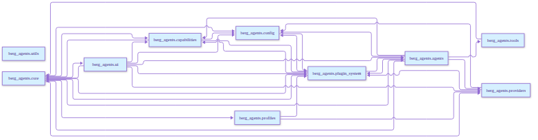

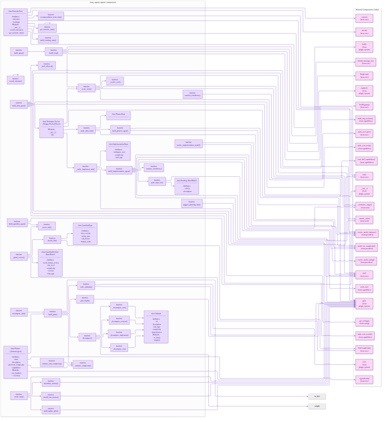

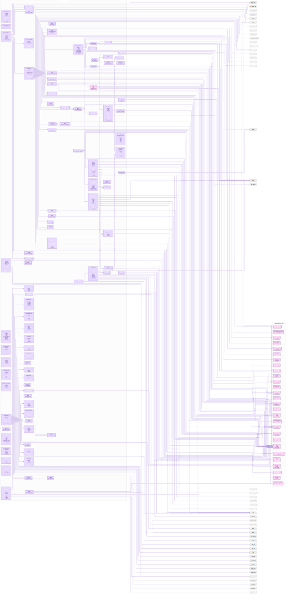

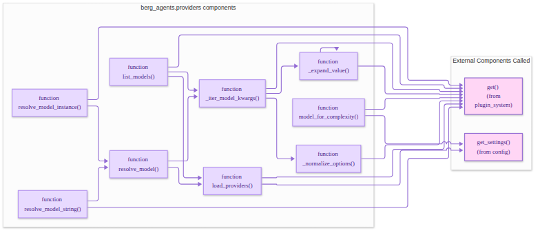

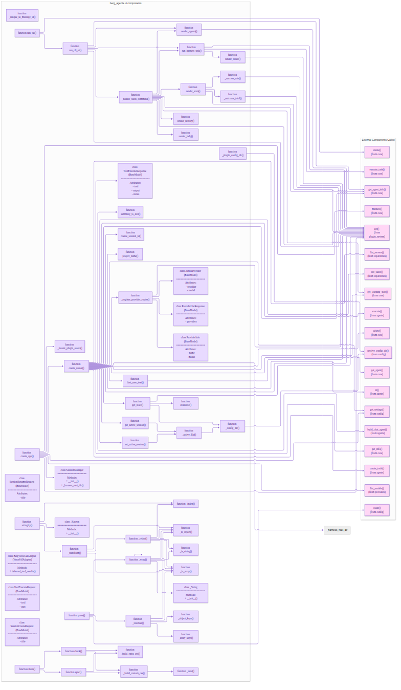

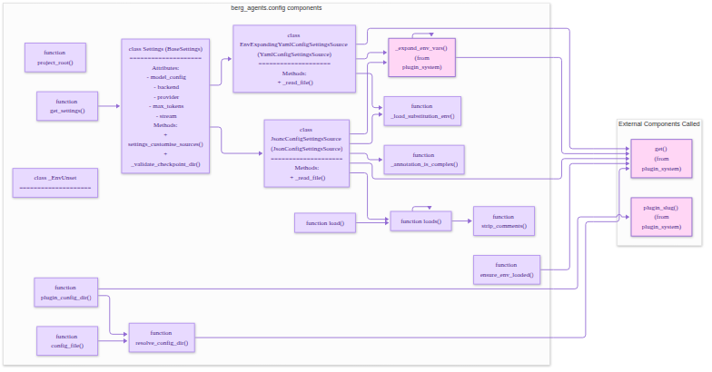

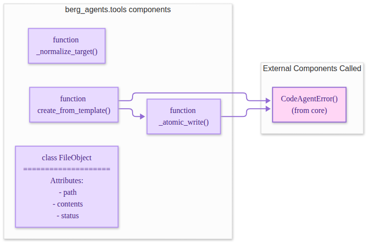

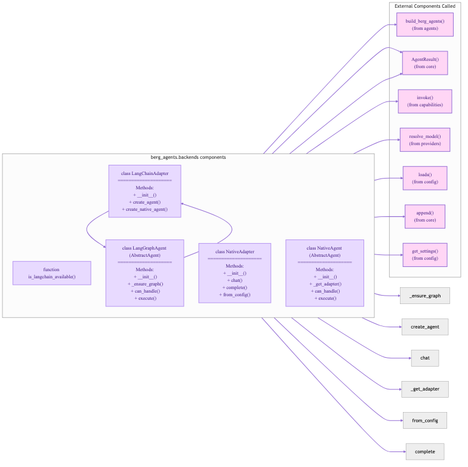

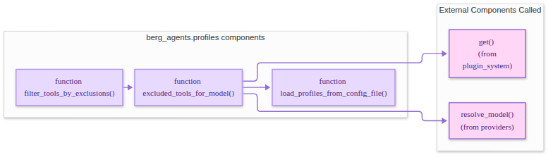

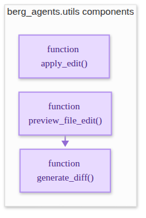

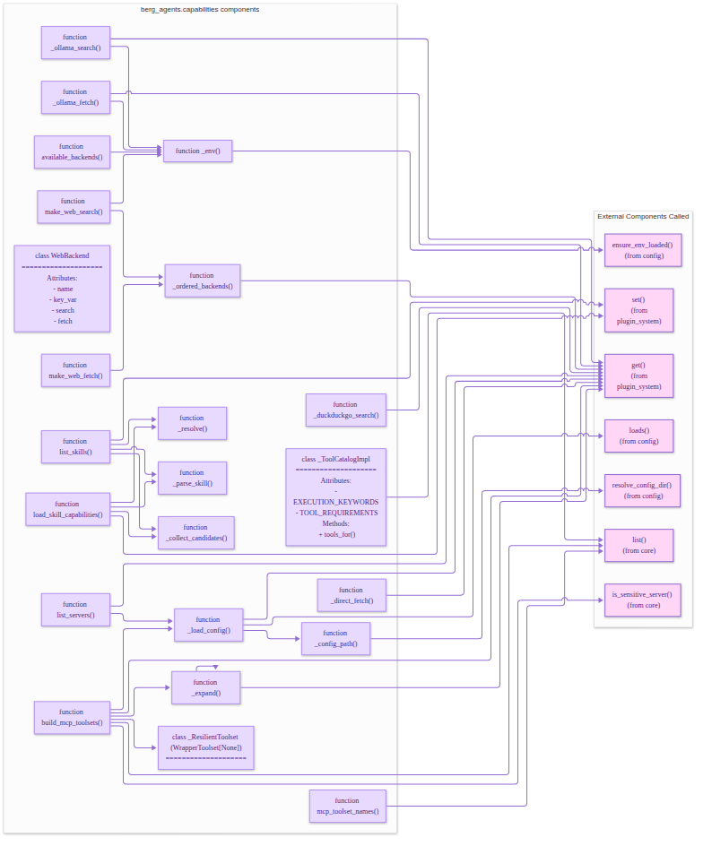

## Public API Overview

  | Module                     | Key classes / functions  | Signature                                                           | Description                                                       | Example                                                                                                                   |
  | --------                   | ------------------------ | -----------                                                         | -------------                                                     | ---------                                                                                                                 |
  | `berg_agents.app`          | `BergAgentsApp`          | `BergAgentsApp.create(config: dict | None = None) -> BergAgentsApp` | Factory that builds a configured Harness + App.                   | `python\n a = BergAgentsApp.create({\"harness\": {\"enable_learning\": false}})\n`                                        |
  | `berg_agents.app`          | `BergAgentsApp.execute`  | `execute(description: str, task_type: str = "standard") -> dict`    | Run a task through the Harness.                                   | `python\nres = a.execute("Summarize README", task_type="standard")\nprint(res)\n`                                         |
  | `berg_agents.core.harness` | `Harness.execute_task`   | `execute_task(task: dict) -> dict`                                  | Core engine orchestrates Guardian→Planner→Implementation→Curator. | `python\nresult = harness.execute_task({"description":"Refactor code", "task_type":"implementation"})\n`                  |
  | `berg_agents.core.loop`    | `BergLoop`               | `BergLoop(agent, tool_specs, max_steps=10)`                         | Low-level LLM↔tool event loop.                                    | `python\nloop = BergLoop(guardian, tool_registry, max_steps=5)\n`                                                         |
  | `berg_agents.mcp`          | `McpClient`              | `McpClient(name: str, transport: str, args: dict)`                  | Client for MCP servers; used internally by tools.                 | `python\nclient = McpClient("github__search", "stdio", '{"command":"gh"}')\n`                                             |
  | `berg_agents.agents`       | `BaseAgent`              | `async def run(self, event: LoopEvents) -> None`                    | Base class for custom agents.                                     | `python\nclass MyAgent(BaseAgent):\n    async def run(self, event):\n        await self.emit("done", {"msg":"ok"})\n`     |

### Typical Usage Snippets

#### 1️⃣ Run a task via the Python API

```python
from berg_agents.app import BergAgentsApp

app = BergAgentsApp.create()

# Run a simple summarization task
result = app.execute(
    "Summarize the content of src/app.py", task_type="standard"
)
print(result)
```

#### 2️⃣ Stream a task's events (SSE)

```bash
curl -N http://127.0.0.1:8001/api/harness/1234/events
```

The response contains `data-*` fields that map to `LoopEvent` objects.

#### 3️⃣ Register a custom agent and use it

```python
# my_package/agents/custom_reviewer.py
class CustomReviewer(BaseAgent):
    async def run(self, event):
        await self.emit("review", {"snippet": event.payload[:100]})


# Register
from berg_agents.agents.factory import register_agent

register_agent("custom_reviewer", CustomReviewer)

# Use in a task
app = BergAgentsApp.create()
res = app.execute(
    "Review README", task_type="standard", agent_name="custom_reviewer"
)
```

#### 4️⃣ Use an MCP tool from Python

```python
from berg_agents.mcp import McpClient

client = McpClient(
    name="github__search", transport="stdio", args={"command": "gh"}
)
response = await client.call()
```

#### 5️⃣ HITL pause and resume via the API

```python
# When the task returns `needs_human_review`, you can programmatically approve:
result = app.execute("Add retry logic", task_type="standard")
if result["status"] == "needs_human_review":
    result = app.execute(
        "",  # empty description to skip further work
        task_type="respond",
        thread_id=result["thread_id"],
        hitl_decision="approve",
    )
```

--------------------------------------------------------------------------------

## Generated diagrams

The diagrams above are automatically generated by the documentation pipeline and should be kept in sync with the directory structure under `visualizations/`.
