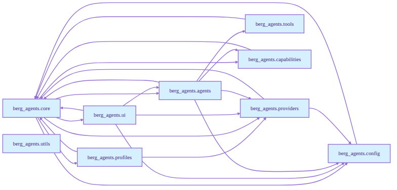
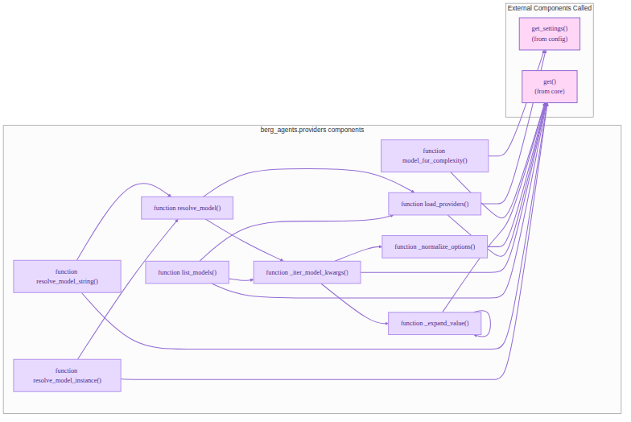
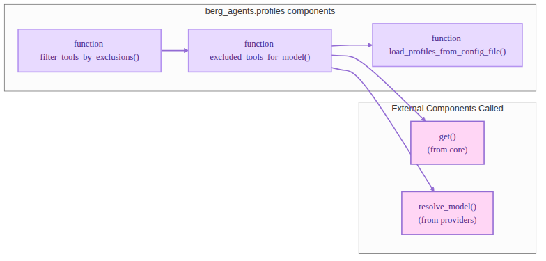

# Configuration

BergAgents uses a **provider-centric configuration** pattern. Each model
belongs to a provider; provider/baseURL/apiKey resolve FROM the model id -
never from a global provider flag.

Layers (increasing precedence):


1. **Config file**: `config/bergagents.jsonc` - `providers` + `harness`/`model_routing`/`hitl_rules`/`plugins`/`agents`
2. **`.env` file**: values referenced from config with `${env:VAR_NAME}` or `{env:VAR}`
3. **Environment variables**: `BERG_AGENT_*` override config and `.env`
4. **MCP config**: `config/mcp.json` (via `BERG_AGENT_MCP_SERVERS`) for MCP servers



## Providers

```jsonc
{
  "providers": {
    "ollama": {
      "options": { "baseURL": "http://localhost:11434/v1", "apiKey": "" },
      "models": { "qwen3.5:9b": {}, "gpt-oss:20b": {} }
    },
    "openai": {
      "options": {
        "baseURL": "https://api.openai.com/v1",
        "apiKey": "${env:OPENAI_API_KEY}"
      },
      "models": { "gpt-4o": {}, "gpt-4o-mini": {} }
    }
  }
}
```

Resolution (`berg_agents/providers/registry.py`):

1. `resolve_model("qwen3.5:9b")` finds the model under its provider block
2. Provider `options` map onto constructor kwargs (`baseURL` → `base_url`, `apiKey` → `api_key`); per-model `options` override them
3. `api_key` defaults to `""`; `{env:VAR}` placeholders expand at load time
4. With no id, the first declared model is the default; unknown ids raise `KeyError` listing known models



## Harness

```jsonc
{
  // Harness engine (framework-agnostic core)
  "harness": { "enable_learning": true, "enable_hitl": true },

  // Model routing - one model list per complexity level (single axis)
  "model_routing": {
    "models": {
      "trivial":  { "models": ["qwen3.5:9b"], "max_tokens": 4096 },
      "standard": { "models": ["gpt-oss:20b"], "max_tokens": 8192 },
      "complex":  { "models": ["gpt-oss:20b"], "max_tokens": 8192 },
      "critical": { "models": ["gpt-4o"], "max_tokens": 128000 }
    }
  },

  // HITL rules - Guardian decides when to ask
  "hitl_rules": {
    "auto_execute": ["read_file", "list_files", "search_code"],
    "notify_after": ["edit_file", "new_file", "generate_test"],
    "ask_before": ["delete_file", "execute_command", "refactor"],
    "human_leads": ["security_change", "production_deploy", "data_migration"]
  },

  // Plugins - optional plugin paths (BergAgents works without them)
  "plugins": [".opencode"],

  // Per-agent tuning - preferred complexity per subagent
  "agents": {
    "guardian":      { "preferred_complexity": "standard" },
    "planner":       { "preferred_complexity": "complex" },
    "implementation":{ "preferred_complexity": "standard" },
    "curator":       { "preferred_complexity": "trivial" },
    "learning":      { "preferred_complexity": "standard" }
  }
}
```

Loaded via `BergAgentsApp.create()` → `Settings` → `Harness`. Subagents: Guardian (risk gate), Planner (breakdown), Implementation (edits), Curator (review), Learning (outcome stats).

## `.env` File

```dotenv
OPENAI_API_KEY=sk-...
GITHUB_PERSONAL_ACCESS_TOKEN=ghp_...
```

## MCP Configuration

External MCP servers live in the file pointed at by `BERG_AGENT_MCP_SERVERS` (default `config/mcp.json`):

```json
[
  { "type": "http", "url": "https://docs.example.com/mcp", "name": "docs" },
  {
    "type": "stdio",
    "command": "npx",
    "args": ["-y", "@modelcontextprotocol/server-github"],
    "name": "github",
    "env": { "GITHUB_PERSONAL_ACCESS_TOKEN": "${env:GITHUB_PERSONAL_ACCESS_TOKEN}" }
  }
]
```

Secrets are never stored in the MCP file - only `${env:VAR}` references. Sensitive servers (`github`, `memory`) pause for approval; read-only servers (`context7`, `docs`, `reference`) run without interruption.

## Profiles

`config/profiles.yaml` tunes prompt suffixes and tool visibility per provider or per `provider:model`:

```yaml
"ollama":
  system_prompt_suffix: "Be concise and prefer minimal, focused diffs."
  excluded_tools: []
```



## Precedence Example

Config file: `BERG_AGENT_TEMPERATURE = 0.7` . `.env`: `BERG_AGENT_TEMPERATURE=0.9` . environment: `BERG_AGENT_TEMPERATURE=0.5` → effective value is `0.5` (environment wins).
