<!-- README.md is generated from README.qmd. Please edit that file -->

```{r}
#| include: false

knitr::opts_chunk$set(
  collapse = TRUE,
  comment = "#>"
)
```

# berg_agents

<!-- badges: start -->

> BergAgents - A local, LLM-driven code assistant with a **framework-agnostic core** and provider-centric configuration.
> Berg Agents is a sophisticated multi-agent system built on Pydantic AI with a modular, extensible architecture.
> The system follows a harness-based execution model with multiple specialized agents working together.
> The system is designed to work against any OpenAI-compatible provider, surfaced through an interactive TUI and a Next.js + FastAPI web UI that share the same commands and task lifecycle.

<!-- badges: end -->



## Quick Start

```bash
# Install dependencies (uv is recommended)
uv venv .venv
source .venv/bin/activate
uv pip install -e .

# Interactive terminal UI
python -m berg_agents --tui

# Web UI (default: http://127.0.0.1:8001)
python -m berg_agents --web
```

## What it is

See [docs/USAGE.qmd](USAGE.qmd) for TUI, Python API, and web examples.


1. **Customizing the Harness via `bergagents.jsonc`**
   ```jsonc
   {
     "providers": {
       "openai": {
         "baseURL": "https://api.openai.com",
         "apiKey": "${env:OPENAI_API_KEY}"
       }
     },
     "harness": {
       "enable_learning": true,
       "enable_inference": true
     },
     "model_routing": {
       "gpt-4o": { "provider": "openai", "complexity": 2 },
       "claude-3-sonnet": { "provider": "anthropic", "complexity": 1 }
     }
   }
   ```
   This file lives in `../.berg-agents` and is automatically merged with environment overrides.

## Configuration

```bash
.berg-agents/bergagents.jsonc   # providers, harness, model_routing, hitl_rules, plugins, agents
.env                      # secrets referenced as `${env:VAR_NAME}`
```

  | Layer          | Source                                                                                 |
  | -------        | --------                                                                               |
  | Config file    | `../.berg-agents` - `providers` block + `harness`/`model_routing`/`hitl_rules`         |
  | Secrets        | `.env` file, referenced with `${env:VAR_NAME}`                                         |
  | Overrides      | `BERG_AGENT_*` environment variables                                                   |
  | External tools | `../.berg-agents` for MCP server configuration                                         |

See [docs/CONFIGURATION.qmd](CONFIGURATION.qmd) for the full reference.


## Documentation

  | Page                                       | Description                                   |
  | ------                                     | -------------                                 |
  | [QUICKSTART](QUICKSTART.qmd)       | Installation and first run                    |
  | [USAGE](USAGE.qmd)                 | TUI, Python API, and web workflows            |
  | [API](API.qmd)                     | Module map for the codebase                   |
  | [TOOLS](TOOLS.qmd)                 | Built-in tools, capabilities, and MCP         |
  | [CONFIGURATION](CONFIGURATION.qmd) | Provider-centric config, `.env`, and env vars |
  | [CONTRIBUTING](CONTRIBUTING.qmd)   | Guidelines for contributing                   |
  | [FAQ](FAQ.qmd)                     | Common questions and troubleshooting          |
  | **TUTORIALS** (this page)                  | Step-by-step examples for common tasks        |

## Getting Help

- Read the [QUICKSTART guide](QUICKSTART.qmd) for installation
- Check [USAGE examples](USAGE.qmd) for common workflows
- See [TOOLS documentation](TOOLS.qmd) to understand agent capabilities
- Review [FAQ](FAQ.qmd) for troubleshooting tips
- API reference is in [API](API.qmd)
- Explore the [TUTORIALS] section above for ready-to-run snippets

## Contributing

Please read our [CONTRIBUTING](CONTRIBUTING.qmd) guide for details on coding standards, testing, and the submission process.

## License

**Version**: 0.2.0 | **License**: GNU Affero General Public License
