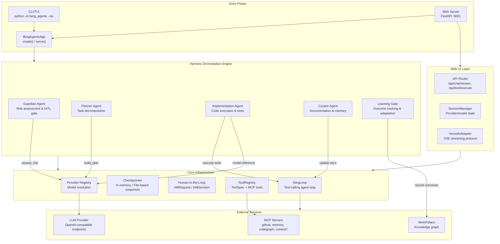
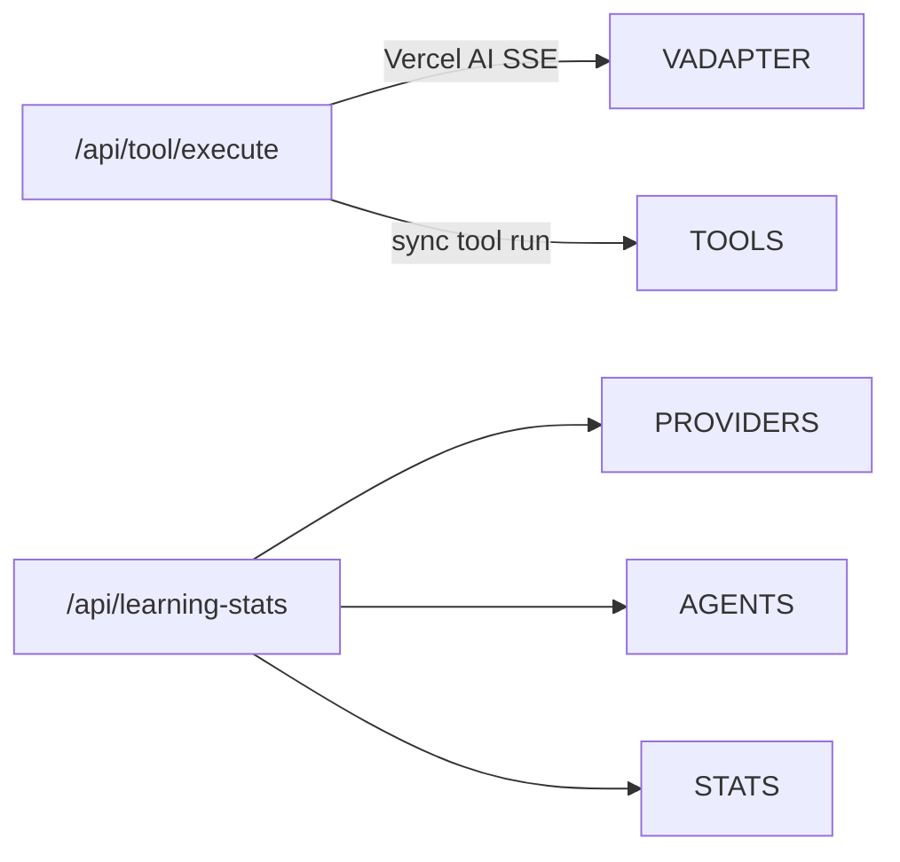

# BergAgents Application Flow Analysis

## Overview

BergAgents is a multi-agent system built on Pydantic AI that orchestrates LLM-powered agents through a deterministic harness pipeline. The system supports both streaming chat (FastAPI web UI) and batch task execution (CLI/TUI).

## Architecture Diagram



## Execution Flow (Task Pipeline)

```mermaid
sequenceDiagram
  participant User
  participant App as BergAgentsApp
  participant Harness as Harness
  participant Guardian as Guardian Agent
  participant Planner as Planner Agent
  participant Impl as Implementation Agent
  participant Curator as Curator Agent
  participant Learning as Learning Gate
  participant Loop as BergLoop
  participant Model as LLM Provider

  User ->> App: execute_task(task)
  App ->> Harness: execute_task(task)

  Harness ->> Harness: estimate_complexity(description, task_type)
  Harness ->> Harness: planner.can_handle(task)
  Harness ->> Harness: estimate_confidence(task_type, description)

  Harness ->> Guardian: guard_review(description, task_type, complexity, confidence)
  Guardian ->> Guardian: assess_risk(description, task_type)
  Guardian ->> Guardian: decide_hitl(task_type, complexity, risk, confidence)

  alt Needs Human Review
    Guardian -->> Harness: GuardianDecision(needs_human_review=true)
    Harness ->> Harness: _apply_mutation_guard(verdict)
    Harness ->> Harness: _plan_mutating_actions(read-only inference)
    Harness -->> User: needs_human_review
    User ->> Harness: approve/edit/reject
    Harness ->> Harness: execute_task with hitl_decision=approve
  else Auto-Execute
    Guardian -->> Harness: GuardianDecision(needs_human_review=false)
  end

  alt Complex/Critical Task
    Harness ->> Planner: build_plan(description, task_type, complexity)
    Planner ->> Planner: decompose(description, task_type)
    Planner ->> Planner: order_subtasks (topological sort)
    Planner -->> Harness: plan with subtasks
  end

  Harness ->> Impl: build_implementation_agent(complexity)
  Impl ->> Model: resolve_model(complexity)
  Impl ->> Impl: register tools (read/write/edit/search/bash)
  Impl ->> Loop: run(messages, tools)

  Loop ->> Model: chat(messages, tools)
  Model -->> Loop: assistant_message

  alt Tool Calls
    Loop ->> Impl: execute tool
    Impl ->> Impl: run tool function
    Impl -->> Loop: tool_result
    Loop ->> Model: chat(messages + tool_result)
  end
  Loop -->> Impl: final_answer

  Harness ->> Curator: curate_task(task, metadata)
  Curator ->> Curator: should_run_curator(files_changed)
  Curator ->> Curator: determine_actions(files_changed)
  Curator ->> Curator: build_update_plan(actions)
  Curator -->> Harness: curation_plan

  Harness ->> Learning: record(task, result, model, success)
  Learning ->> Learning: update outcome stats
  Learning ->> Learning: evaluate_routing_rules
  Learning ->> MemPalace: store insight (manual)

  Harness -->> User: result(status, task_id, model, plan, curation)
```

## Core Components

### 1. BergAgentsApp (app.py)

- Main application class that wires together the harness and web server
- Factory method `create(config)` builds a configured Harness instance
- `serve()` starts the FastAPI server on port 8001
- `execute(description, task_type)` runs a single task through the harness

### 2. Harness (core/harness/orchestrator.py)

The deterministic orchestration engine that coordinates all agents:

| Stage | Agent              | Responsibility                                           |
| ----- | ------------------ | -------------------------------------------------------- |
| 1     | **Guardian**       | Assess risk (LOW/MEDIUM/HIGH/CRITICAL), decide HITL gate |
| 2     | **Planner**        | Decompose complex/critical tasks into ordered subtasks   |
| 3     | **Implementation** | Execute task using tools (read/write/edit/search/bash)   |
| 4     | **Curator**        | Update docs/memory when files_changed metadata present   |
| 5     | **Learning Gate**  | Record outcomes, track success rates, adapt routing      |

### 3. Guardian Agent (agents/guardian.py)

**Risk Assessment:**

- Pattern matching against HIGH_RISK_PATTERNS (delete, deploy, credentials, etc.)
- Pattern matching against MEDIUM_RISK_PATTERNS (refactor, migrate, configure, etc.)
- Task-type fallback for exact labels

**HITL Decision Matrix:**

| Condition                  | Action        |
| -------------------------- | ------------- |
| Critical complexity        | Always review |
| High/Critical risk         | Always review |
| Confidence < 0.6           | Always review |
| Task in `human_leads` list | Always review |
| Task in `ask_before` list  | Always review |
| All else                   | Auto-execute  |

### 4. Planner Agent (agents/planner.py)

**Complexity Estimation:**

- CRITICAL: delete, security, production keywords
- COMPLEX: refactor, architecture, multi_file
- TRIVIAL: read_file, list_files, search
- STANDARD: everything else

**Decomposition Templates:**

- **Refactor:** analyze → plan → edit → test
- **Implement:** plan → create → test
- **Fix:** diagnose → fix → regression test
- **Test:** identify paths → generate tests

### 5. Implementation Agent (agents/implementation.py)

**Tool Registry (built into agent):**

| Tool        | Risk | Description               |
| ----------- | ---- | ------------------------- |
| read_file   | LOW  | Read workspace file       |
| list_files  | LOW  | List directory contents   |
| search_code | LOW  | Grep-style search         |
| bash        | HIGH | Run shell command         |
| write_file  | HIGH | Create/overwrite file     |
| edit_file   | HIGH | Replace file contents     |
| patch_file  | HIGH | Surgical text replacement |

**Model Routing by Complexity:**

- trivial → smallest/fastest model
- standard → balanced model
- complex → capable model
- critical → strongest model

### 6. Curator Agent (agents/curator.py)

Runs when `metadata.files_changed` is present:

- Updates documentation for changed files
- Records patterns to `context/examples/`
- Records decisions to `decisions/decisions-log.md`
- Fallback: update `context/technical-domain.md` for complex tasks

### 7. BergLoop (core/loop.py)

Framework-free agentic tool-calling loop:

- Drives LLM through tool calls until completion
- Yields typed events: RunStarted, StepStart, ToolCallRequest, ToolCallResult, HitlRequired, RunCompleted, etc.
- Supports HITL pause/resume with checkpoint persistence
- Max 25 steps per default

### 8. Learning Gate (core/learning_gate.py)

- Records outcomes to SQLite (`agent_state.db`)
- Tracks success rates by task_type and model
- Adjusts routing when:
  - Success rate < 40% → complexity upgrade suggested
  - Success rate > 95% with 10+ outcomes → complexity downgrade considered
- Stores insights to MemPalace (manual, not automatic)

## Web API Endpoints



| Endpoint                | Method   | Description                                 |
| ----------------------- | -------- | ------------------------------------------- |
| `/api/chat/stream`      | POST     | Streaming chat via Vercel AI protocol (SSE) |
| `/api/tool/execute`     | POST     | Sync tool execution (slash commands)        |
| `/api/providers`        | GET      | List configured provider/model pairs        |
| `/api/providers/active` | GET/POST | Get/set active provider/model               |
| `/api/agents`           | GET      | List registered agents                      |
| `/api/agents/{name}`    | GET      | Get agent info                              |
| `/api/learning-stats`   | GET      | Outcome statistics                          |
| `/api/health`           | GET      | Liveness probe                              |

## MCP Integration

Tools from MCP servers are prefixed with `mcp_<server>__`:

- **Sensitive servers** (github, memory): Always require HITL approval
- **Read-only servers** (codegraph, context7): Run autonomously
- Transports: stdio (subprocess) or HTTP (SSE)
- No third-party dependencies (urllib only)

## Configuration

All config from `config/bergagents.jsonc` or `config/bergagents.yaml`:

- `providers`: LLM endpoints (base_url, api_key, models)
- `model_routing`: Model selection per complexity level
- `hitl_rules`: Custom HITL gate lists
- `agents`: Per-agent overrides (preferred_complexity)
- `mcp_servers`: MCP server connections
- `harness`: Enable/disable learning and inference

## CLI Commands

| Command                  | Description              |
| ------------------------ | ------------------------ |
| `/help`                  | Show slash commands      |
| `/agents`                | List registered agents   |
| `/harness <description>` | Run task through harness |
| `/stats`                 | Learning statistics      |
| `/history`               | Session transcript       |
| `/clear`                 | Clear console            |
